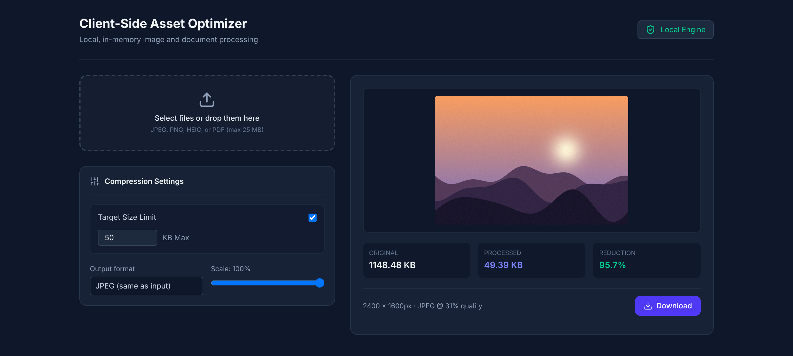

<div align="center">

# Image Resizer

**Shrink images and PDFs to an exact file size, right in your browser.**
Type a target like `50 KB` and the app finds the highest quality that fits. Nothing is ever uploaded.


<br />



</div>

---

## Why this exists

Application portals, government forms and email attachments love to say *"file must be under 50 KB"*. Most online compressors make you guess a quality setting, upload your private documents to a stranger's server, and then tell you the result is still too big.

Image Resizer flips that around. You choose the size you need, and it searches for the best quality that still fits, all on your own device.

## Features

- **Target-size compression.** Enter a limit in KB and the app searches for the highest quality that stays under it.
- **Four formats.** JPEG, PNG, HEIC/HEIF and PDF, each handled in its own way (see below).
- **Private by design.** Files are decoded, compressed and downloaded entirely in your browser. There is no backend and no upload.
- **Real HEIC support.** iPhone photos are decoded *and* re-encoded as HEIC using WebAssembly, which browsers can't do on their own.
- **Whole-document PDF targets.** For PDFs, the size limit applies to the entire file, not page by page.
- **Manual control.** Turn the target off to get a quality slider, and use the scale slider (10% to 100%) to reduce dimensions.
- **Live results.** See the original size, new size, percentage saved, final dimensions and the quality that was chosen.
- **Several files at once.** Drop in a batch, switch between them with tabs, and download each result.

## How it works

| Format | What the app does |
| --- | --- |
| **JPEG** | Binary-searches the encoder quality until the file fits under your target. |
| **PNG** | Re-encodes losslessly. PNG has no quality dial, so the scale slider is what shrinks it, and the app tells you if the target wasn't reached. |
| **HEIC / HEIF** | Decodes with `icodec` (WebAssembly), then binary-searches quality using a HEIC encoder that runs in a Web Worker so it doesn't freeze the page. |
| **PDF** | Renders every page with `pdf.js`, then rebuilds the document with `pdf-lib`, using one shared JPEG quality that is searched so the whole file lands under the target. |

The output format always matches the input, so a JPEG stays a JPEG and a HEIC stays a HEIC.

## Getting started

You need **Node.js 20.19+** (or 22.12+), which is what Vite 8 requires.

```bash
git clone https://github.com/SarthakCodes170607/image-resizer.git
cd image-resizer
npm install
npm run dev
```

Then open the local address that Vite prints (usually `http://localhost:5173`).

Other scripts:

| Command | What it does |
| --- | --- |
| `npm run build` | Creates an optimized production build in `dist/`. |
| `npm run preview` | Serves the production build locally. |
| `npm run lint` | Runs [Oxlint](https://oxc.rs) over the project. |

## Tech stack

- [React 19](https://react.dev) for the interface
- [Vite 8](https://vite.dev) for dev server and bundling
- [Tailwind CSS 4](https://tailwindcss.com) for styling
- [pdf.js](https://mozilla.github.io/pdf.js/) to render PDF pages
- [pdf-lib](https://pdf-lib.js.org) to build the compressed PDF
- [icodec](https://github.com/Kaciras/icodec) for HEIC encoding and decoding in WebAssembly
- [lucide-react](https://lucide.dev) for icons

## Project structure

```text
image-resizer/
├── index.html
├── vite.config.js
├── docs/
│   └── screenshot.png
├── public/                      # favicon and static icons
└── src/
    ├── main.jsx                 # React entry point
    ├── App.jsx                  # UI, file loading, per-format processing
    ├── heicEncoder.worker.js    # HEIC encoding in a Web Worker
    └── utils/
        └── compressor.js        # target-size search for JPEG and PDF
```

## Good to know

- **PDF output is image-based.** Pages are turned into pictures and re-embedded, which shrinks scanned or image-heavy PDFs a lot, but text in the result can no longer be selected or searched.
- **PNG is lossless**, so a very large PNG may not reach a small target unless you also lower the scale.
- **Files are limited to 25 MB each.**
- **The PDF preview shows page 1 only.** Download the result to see every page.
- Most compression work runs on the page's main thread (only HEIC encoding uses a worker), so the interface may pause briefly on very large files.

---

<div align="center">

Built by [@SarthakCodes170607](https://github.com/SarthakCodes170607)

</div>
